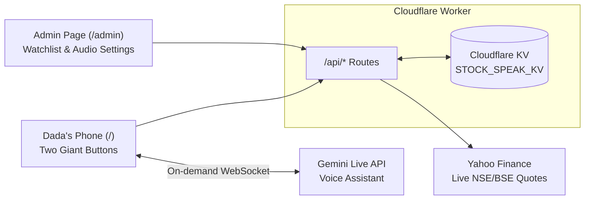

<div align="center">
  
  <h1>Stock-Speak</h1>
  <p>A voice-first Indian stock market app for my grandfather.</p>
</div>

My grandfather loves tracking the stock market, but he has severe vision loss. He cannot read text on a screen and can only make out big, bright colored shapes against a pure black background.

I built this so he can check his NSE and BSE stocks on a basic Android phone without needing anyone to read the screen for him, and so I can manage his watchlist and audio settings remotely from my own phone.

## How it works

The app is split into two views served from the same Cloudflare Worker:

- **Dada's screen (`/`):** Pure black background with two giant half-screen buttons.
  - **Top button (Yellow):** Reads his entire stock watchlist aloud in Gujarati or Hindi (`window.speechSynthesis`, falling back to a `/api/tts` audio stream if the phone lacks a local voice pack). It uses fixed text templates so prices are never hallucinated.
  - **Bottom button (Cyan):** Opens a live voice conversation with Gemini (`models/gemini-3.8-live`) so he can ask for the live price of any other Indian stock, or ask to add or remove a stock from his watchlist using his voice. Removing a stock asks for spoken confirmation ("હા" / "ના") instead of showing a popup he can't read.
- **Caregiver screen (`/admin`):** A PIN-protected page where I can edit his watchlist, change speech speed, switch between rounded rupees (`1451 રૂપિયા`) and exact paise, toggle language (`gu` / `hi`), or swap the Gemini model ID if Google deprecates one. Changes are saved to Cloudflare KV with a version counter (`configVersion`) so his phone updates its local cache automatically.



## Running it yourself

If you want to run or adapt this for someone in your family, everything fits on the free tiers of Cloudflare Workers/KV and Google AI Studio.

### Prerequisites

- Node.js 20+ and npm
- A Cloudflare account (Workers + KV)
- A Google AI Studio API key (`GEMINI_API_KEY`)

### Local development

1. Install dependencies:

   ```bash
   npm install
   ```

2. Copy the environment file and fill in your keys:

   ```bash
   cp .dev.vars.example .dev.vars
   ```

   - `GEMINI_API_KEY`: Google AI Studio key for the voice assistant
   - `DADA_DEVICE_SECRET`: Any random secret string used to authorize the phone
   - `ADMIN_PIN`: PIN for `/admin` and emergency device unlock

3. Build the frontend and start the local Worker:

   ```bash
   npm run dev
   ```

### Deploying to Cloudflare

1. Create a KV namespace in Cloudflare and replace the `kv_namespaces[0].id` in [wrangler.jsonc](wrangler.jsonc) with your own namespace ID.
2. Push your secrets and deploy:

   ```bash
   npx wrangler secret put GEMINI_API_KEY
   npx wrangler secret put DADA_DEVICE_SECRET
   npx wrangler secret put ADMIN_PIN
   npm run deploy
   ```

### Setting up the phone

So my grandfather never has to type a password, auth works via a one-time setup link:

1. Open `https://<your-worker-url>/?setup=<DADA_DEVICE_SECRET>` on the phone once (you can also copy this link from `/admin`).
2. The app saves the key in `localStorage` and a long-lived cookie, then removes `?setup=` from the address bar.
3. Add the page to the Android home screen (`Add to Home screen`) so it opens full-screen like a regular app.

## Good to know

- **Quotes & TTS sources:** Stock prices and search use Yahoo Finance's public JSON endpoints (`v8/finance/chart` and `v1/finance/search`), and fallback TTS uses Google Translate's audio endpoint. Neither requires a paid API key, though both are unofficial.
- **Rate limits:** Basic per-IP rate limiting is built into [worker/index.ts](worker/index.ts) to keep bots from burning through the Gemini key or Worker quota.
- **More notes:** Deeper notes on the KV schema, UI rules, and past changes are in [docs/ARCHITECTURE.md](docs/ARCHITECTURE.md), [docs/DESIGN.md](docs/DESIGN.md), and [docs/DECISIONS.md](docs/DECISIONS.md).
