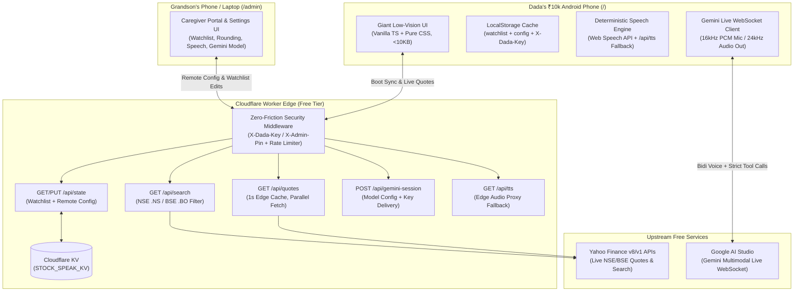

# Stock-Speak (`stock-speak`) — System Architecture

## 1. Executive Summary
**Stock-Speak** is a single-deployment Progressive Web App (PWA) and Serverless Edge API hosted on **Cloudflare Workers + Static Assets + Cloudflare KV**.

It serves two distinct personas from one codebase:
1. **Dada's View (`/`)**: A hyper-optimized, zero-lag, high-contrast voice stock reader for a budget ₹10k Android smartphone.
2. **Grandson's Caregiver Portal (`/admin`)**: A remote control panel and settings dashboard allowing the grandson (living 100km away) to manage Dada's watchlist, tune voice/price settings (paise rounding, speech speed, language, TTS engine), hot-swap the Gemini Live model ID if Google deprecates a model, and trigger a remote cache reset on Dada's phone.

---

## 2. High-Level Topology



---

## 3. Directory & File Structure Blueprint

When implementing the code with Gemini Flash, strictly follow this directory structure:

```text
stock-speak/
├── docs/
│   ├── AGENT.md               # <500 token router
│   ├── ARCHITECTURE.md        # Technical specification (this file)
│   ├── DESIGN.md              # Low-vision UI & Caregiver Portal UX specs
│   ├── DECISIONS.md           # Chronological ADR log
│   └── CONTEXT-HANDOFF.md     # End-of-session handoff state
├── public/
│   ├── manifest.webmanifest   # PWA install manifest (fullscreen/standalone, #000000)
│   ├── sw.js                  # Lightweight Service Worker for app-shell caching
│   ├── icon-192.png           # High-contrast yellow/black app icon
│   └── icon-512.png
├── src/
│   ├── types.ts               # Shared TypeScript interfaces (StockItem, AppConfig, QuoteData)
│   ├── defaults.ts            # Default Indian Blue-Chip stocks + default AppConfig
│   ├── state.ts               # LocalStorage + Cloudflare KV `/api/state` sync & `configVersion` check
│   ├── api.ts                 # Fetch wrapper injecting `X-Dada-Key` / `X-Admin-Pin` headers
│   ├── speech.ts              # Deterministic Gujarati/Hindi speech formatter + Web Speech / Edge TTS
│   ├── gemini-live.ts         # On-demand WebSocket client + PCM AudioWorklet + tool execution
│   ├── ui-dada.ts             # Dada's main high-contrast view & Giant Green/Red confirmation modal
│   ├── ui-admin.ts            # Grandson's `/admin` Caregiver Portal & Settings dashboard
│   ├── main.ts                # Entry point routing `/` (or `?setup=...`) vs `/admin`
│   └── styles.css             # Zero-lag, high-contrast CSS (no animations/shadows/blurs)
├── worker/
│   └── index.ts               # Cloudflare Worker entry point handling `/api/*` & static assets
├── index.html                 # Single HTML shell with high-contrast inline critical background
├── package.json               # Scripts: `dev`, `build`, `deploy`, `typecheck`
├── tsconfig.json              # Strict TypeScript config
├── vite.config.ts             # Vite build config targeting ES2020 with minification
├── wrangler.jsonc             # Cloudflare Worker + Assets + KV binding config
└── .dev.vars.example          # Template for GEMINI_API_KEY, DADA_DEVICE_SECRET, ADMIN_PIN
```

---

## 4. Data Models & Cloudflare KV Schema (`src/types.ts`)

All persistent state is stored in a single Cloudflare KV namespace bound as `STOCK_SPEAK_KV` under two keys: `watchlist:main` and `config:main`.

### 4.1 Watchlist Schema (`watchlist:main`)
```typescript
export interface StockItem {
  symbol: string;       // e.g., "RELIANCE.NS" or "TCS.BO"
  exchange: 'NSE' | 'BSE';
  nameEn: string;       // "Reliance Industries"
  nameGu: string;       // "રિલાયન્સ" (Spoken & displayed in Gujarati mode)
  nameHi: string;       // "रिलायंस" (Spoken & displayed in Hindi mode)
}
```

**Starter Indian Blue-Chip Watchlist (`src/defaults.ts`)**:
| Symbol | Exchange | English (`nameEn`) | Gujarati (`nameGu`) | Hindi (`nameHi`) |
| :--- | :--- | :--- | :--- | :--- |
| `RELIANCE.NS` | NSE | Reliance | રિલાયન્સ | रिलायंस |
| `TCS.NS` | NSE | TCS | ટીસીએસ | टीसीएस |
| `HDFCBANK.NS` | NSE | HDFC Bank | એચડીએફસી બેંક | एचडीएफसी बैंक |
| `SBIN.NS` | NSE | State Bank (SBI) | એસબીઆઈ બેંક | एसबीआई बैंक |
| `TMPV.NS` | NSE | Tata Motors | ટાટા મોટર્સ | टाटा मोटर्स |
| `ITC.NS` | NSE | ITC | આઈટીસી | आईटीसी |
| `LT.NS` | NSE | Larsen & Toubro | એલ એન્ડ ટી | एल एंड टी |

### 4.2 Remote Caregiver Settings Schema (`config:main`)
```typescript
export interface AppConfig {
  /** Incremented automatically on every save in /admin. Forces Dada's phone to overwrite local cache. */
  configVersion: number;

  /** Primary language on Dada's phone */
  language: 'gu' | 'hi';

  /** Whether to show the GU/HI toggle button on Dada's screen (can be hidden if Dada taps it by mistake) */
  showLanguageToggle: boolean;

  /** Price rounding mode:
   * - 'round': Round to nearest whole rupee (e.g. ₹1450.60 -> "1451 રૂપિયા") [Default]
   * - 'exact_paise': Speak exact decimals / paise (e.g. "1450 રૂપિયા 60 પૈસા" / "1450 point 60")
   * - 'smart': Round if price >= ₹100, speak exact paise if price < ₹100
   */
  priceRounding: 'round' | 'exact_paise' | 'smart';

  /** Whether to announce percentage change in addition to rupee change */
  announcePercentChange: boolean;

  /** Speech rate multiplier for Web Speech API (0.6 = very slow, 0.85 = default clear speed, 1.0 = normal) */
  speechRate: number;

  /** Pause duration in milliseconds between stocks when reading "SPEAK ALL" (default: 1200ms) */
  pauseBetweenStocksMs: number;

  /** TTS Engine selection:
   * - 'auto': Try native Android Web Speech API (`gu-IN`/`hi-IN`) first; fallback to `/api/tts` edge proxy
   * - 'native_only': Force `window.speechSynthesis`
   * - 'edge_tts_only': Force `/api/tts` MP3 stream (useful if Dada's phone has a broken local voice pack)
   */
  ttsEngine: 'auto' | 'native_only' | 'edge_tts_only';

  /** Whether the bottom "AI Assistant" button is visible on Dada's screen (kill-switch for Grandson) */
  enableGeminiAssistant: boolean;

  /** Configurable Gemini Multimodal Live model identifier so Grandson can update it without redeploying code */
  geminiModel: string; // e.g., "models/gemini-2.0-flash-exp" or Gemini 3.8 Live Thinking model ID

  /** Gemini Live voice preset ("Puck" | "Charon" | "Kore" | "Fenrir" | "Aoede") */
  geminiVoiceName: string;

  /** Require Giant GREEN/RED screen confirmation before removing a stock (default: true) */
  requireRemoveConfirmation: boolean;

  /** Auto-disconnect Gemini Live after N seconds of silence (default: 30) */
  geminiSilenceTimeoutSec: number;

  /** Timestamp of last update */
  updatedAt: string;
}
```

### 4.3 Live Quote Response Schema (`QuoteData`)
```typescript
export interface QuoteData {
  symbol: string;             // "RELIANCE.NS"
  regularMarketPrice: number; // 1450.25
  previousClose: number;      // 1435.00
  change: number;             // +15.25
  percentChange: number;      // +1.06
  marketTime: string;         // ISO timestamp of exact second
  currency: string;           // "INR"
}
```

---

## 5. Zero-Friction Security Architecture (Anti-Bot / Anti-Scraper)

Because this app runs on free tiers (Cloudflare Workers + KV + Google AI Studio), random web scanners or bots finding the `.workers.dev` URL must **never** be able to trigger Gemini Live sessions or spam KV/quote endpoints. At the same time, **Dada must never have to type a password or PIN**.

### 5.1 How Dada's Phone Authenticates (One-Time Magic Setup Link)
1. You set a secret environment variable in Cloudflare: `DADA_DEVICE_SECRET` (e.g., `dada-guj-9942-secret`).
2. When you first set up Dada's phone (or send him a WhatsApp link), you open:
   `https://stock-speak.<your-subdomain>.workers.dev/?setup=dada-guj-9942-secret`
3. On boot, `src/main.ts` reads `?setup=...`, saves it permanently in `localStorage.setItem('dada_device_key', secret)` AND a 10-year first-party cookie, and immediately cleans the URL bar via `history.replaceState({}, '', '/')` before you tap **"Add to Home Screen"**.
4. Every API request from Dada's phone includes the header `X-Dada-Key: <secret>`.
5. **What if Dada clears his browser data while you are 100km away?**
   - If Dada opens the app without a valid `X-Dada-Key`, the screen shows a single giant friendly box with a **4-digit Caregiver Unlock Code** input (or he clicks the WhatsApp link you text him). Entering your `ADMIN_PIN` once re-provisions `X-Dada-Key` on his phone automatically!

### 5.2 How Grandson's `/admin` Portal Authenticates
1. You set `ADMIN_PIN` in Cloudflare Worker secrets (e.g., a 6-digit PIN or passphrase).
2. Navigating to `/admin` prompts for your `ADMIN_PIN`, stores it in `sessionStorage` (or `localStorage` if "Remember my device" is checked), and sends `X-Admin-Pin: <PIN>` on all `PUT /api/state` and `/admin` requests.
3. `X-Admin-Pin` is a superset of `X-Dada-Key` (it can authorize both read and write endpoints).

### 5.3 Edge Rate Limiting & Origin Protection
1. **Strict Auth Check**: Any request to `/api/*` without a valid `X-Dada-Key` or `X-Admin-Pin` immediately returns `401 Unauthorized` at the Worker edge (0 KV reads, 0 upstream calls).
2. **In-Memory Isolate Rate Limiter**:
   - `/api/quotes` & `/api/tts`: Max 60 requests / minute per IP.
   - `/api/gemini-session`: Max 10 requests / minute per IP.
   - Failed auth attempts (`401`): Max 5 failed attempts per 10 minutes per IP before returning `429 Too Many Requests`.

---

## 6. Cloudflare Worker API Specification (`worker/index.ts`)

### 6.1 `GET /api/state`
- **Auth**: `X-Dada-Key` or `X-Admin-Pin`
- **Action**: Fetches `watchlist:main` and `config:main` in parallel from `STOCK_SPEAK_KV`. If either is null (first boot), seeds KV with `DEFAULT_WATCHLIST` and `DEFAULT_CONFIG`.
- **Response**: `{ watchlist: StockItem[], config: AppConfig }`

### 6.2 `PUT /api/state`
- **Auth**: `X-Dada-Key` (allowed to update `watchlist` only via Gemini Live tool calls) or `X-Admin-Pin` (allowed to update both `watchlist` and `config`, incrementing `config.configVersion`).
- **Action**: Validates payload, writes to `STOCK_SPEAK_KV`, returns updated `{ watchlist, config }`.

### 6.3 `GET /api/quotes?symbols=RELIANCE.NS,TCS.NS`
- **Auth**: `X-Dada-Key` or `X-Admin-Pin`
- **Action**:
  - Splits `symbols` (max 25 tickers).
  - Fetches `https://query1.finance.yahoo.com/v8/finance/chart/${ticker}?interval=1m&range=1d` concurrently using `Promise.all` with `User-Agent: Mozilla/5.0`.
  - Extracts `meta.regularMarketPrice`, `meta.chartPreviousClose || meta.previousClose`, `meta.regularMarketTime`.
  - Computes `change = regularMarketPrice - previousClose` and `percentChange = (change / previousClose) * 100`.
- **Caching**: Uses `Cache-Control: public, max-age=1` so simultaneous taps within 1 second share the edge response while always giving Dada fresh-to-the-second prices.

### 6.4 `GET /api/search?q=tata`
- **Auth**: `X-Dada-Key` or `X-Admin-Pin`
- **Action**:
  - Calls `https://query2.finance.yahoo.com/v1/finance/search?q=${encodeURIComponent(q)}&quotesCount=10&newsCount=0`.
  - Filters results strictly to Indian exchanges (`exchange === 'NSI'` or `exchange === 'BSE'`, or symbol ending in `.NS` / `.BO`) and `quoteType === 'EQUITY'`.
  - Returns top 5 clean matches: `[{ symbol: "TMPV.NS", shortname: "Tata Motors", exchange: "NSE" }]`.

### 6.5 `GET /api/tts?lang=gu&text=...` (Edge TTS Fallback)
- **Auth**: `X-Dada-Key` or `X-Admin-Pin` (or signed query param `?key=...` for `<audio src="...">`)
- **Action**:
  - Some ultra-budget ₹10k Chinese Android phones (Xiaomi/Realme/Vivo entry models) ship without the local Gujarati (`gu-IN`) speech synthesis pack installed.
  - If `window.speechSynthesis.getVoices()` has no `gu-IN` / `hi-IN` voice (or if Grandson selects `ttsEngine: 'edge_tts_only'` in `/admin`), the client plays audio from `/api/tts?lang=gu&text=...`.
  - The Worker proxies `https://translate.google.com/translate_tts?ie=UTF-8&client=tw-ob&tl=${lang}&q=${encodeURIComponent(text)}` and streams back `audio/mpeg` with edge caching (`max-age=60`).

### 6.6 `POST /api/gemini-session`
- **Auth**: `X-Dada-Key` or `X-Admin-Pin`
- **Action**:
  - Reads `config:main` from KV to check `enableGeminiAssistant` and get the active `geminiModel` and `geminiVoiceName`.
  - Returns `{ wsUrl, model: config.geminiModel, voiceName: config.geminiVoiceName, silenceTimeoutSec: config.geminiSilenceTimeoutSec }` where `wsUrl` is constructed with `env.GEMINI_API_KEY`.

---

## 7. Deterministic Speech Pipeline (`src/speech.ts`)

1. **Zero LLM Rule**: Stock prices are **never** passed through Gemini or any generative model.
2. **Formatting Logic based on `AppConfig.priceRounding`**:
   - **`round` (Default)**:
     - `priceStr = Math.round(quote.regularMarketPrice).toString()`
     - `changeAbs = Math.round(Math.abs(quote.change)).toString()`
     - If `Math.abs(quote.change) > 0 && Math.abs(quote.change) < 1`, speak `"1 કરતા ઓછો"` (less than 1) or exact paise.
   - **`exact_paise`**:
     - Splits rupees and paise: `1450.25` -> `1450 રૂપિયા 25 પૈસા` (Gujarati) / `1450 रुपये 25 पैसे` (Hindi).
   - **`smart`**:
     - Uses `round` when `regularMarketPrice >= 100`, and `exact_paise` when `< 100`.
3. **Exact Phrase Templates**:
   - **Gujarati (`gu`)**:
     - Price Up (`change > 0`): `"{nameGu}, ભાવ {price}, {change} વધ્યો."` (e.g., *"રિલાયન્સ, ભાવ 1450 રૂપિયા, 15 રૂપિયા વધ્યો."*)
     - Price Down (`change < 0`): `"{nameGu}, ભાવ {price}, {change} ઘટ્યો."` (e.g., *"ટીસીએસ, ભાવ 3920 રૂપિયા, 22 રૂપિયા ઘટ્યો."*)
     - Unchanged (`change === 0`): `"{nameGu}, ભાવ {price}, કોઈ ફેરફાર નથી."`
   - **Hindi (`hi`)**:
     - Price Up (`change > 0`): `"{nameHi}, भाव {price}, {change} बढ़ा."`
     - Price Down (`change < 0`): `"{nameHi}, भाव {price}, {change} गिरा."`
     - Unchanged (`change === 0`): `"{nameHi}, भाव {price}, कोई बदलाव नहीं."`
4. **Queue & Interruption Handling**:
   - Tapping any stock card immediately cancels any ongoing speech (`speechSynthesis.cancel()`), vibrates for `50ms`, highlights that card with a thick `#FFD600` outline, fetches fresh quotes (if >2s old), and speaks that single stock.
   - Tapping the giant top **SPEAK ALL** button while already speaking stops the readout immediately (acting as a giant Panic/Stop button).

---

## 8. Foolproof Gemini Live Thinking Integration (`src/gemini-live.ts`)

### 8.1 Connection Lifecycle
1. **Strictly On-Demand**: No microphone permission or WebSocket connection is active during normal app usage.
2. When Dada taps the bottom **AI Assistant (`નવો શેર ઉમેરો કે કાઢો`)** button:
   - Fetches `/api/gemini-session`.
   - Opens WebSocket to `wss://generativelanguage.googleapis.com/ws/google.ai.generativelanguage.v1alpha.GenerativeService.BidiGenerateContent?key=${apiKey}`.
   - Sends initial `setup` message with:
     - `model`: `config.geminiModel` (adjustable anytime from `/admin`!).
     - `generationConfig`: `{ responseModalities: ["AUDIO"], speechConfig: { voiceConfig: { prebuiltVoiceConfig: { voiceName: config.geminiVoiceName } } } }`.
     - `systemInstruction`: Strict Gujarati + Hindi prompt instructing the model to address Dada respectfully (*"દાદા"* / *"दादाजी"*), keep answers under 2 short sentences, NEVER quote or guess stock prices, and ONLY use the provided tools to search, add, or propose removing stocks from his list.

### 8.2 Strict Tool Declarations (Anti-Hallucination)
1. `search_indian_stock({ query: string })`:
   - Calls `GET /api/search?q=${query}` on our Cloudflare Worker.
   - Returns verified NSE/BSE ticker symbols and company names to Gemini so Gemini **cannot** invent a ticker symbol.
2. `add_stock_to_watchlist({ symbol: string, nameEn: string, nameGu: string, nameHi: string })`:
   - Verifies `symbol` ends with `.NS` or `.BO`.
   - Adds the stock to `watchlist`, syncs to `/api/state`, re-renders Dada's screen immediately, and returns `{ status: "added" }` so Gemini confirms verbally (*"દાદા, ટાટા સ્ટીલ તમારા લિસ્ટમાં ઉમેરાઈ ગયો છે."*).
3. `propose_remove_stock({ symbol: string })`:
   - Does **NOT** delete the stock immediately if `config.requireRemoveConfirmation === true`.
   - Triggers the full-screen **Giant GREEN / RED Confirmation Modal** on Dada's screen:
     - Top half (`#00E676` Bright Green): **"હા, કાઢી નાખો (YES, REMOVE)"**
     - Bottom half (`#FF5252` Bright Red): **"ના, રહેવા દો (NO, KEEP)"**
   - Also allows Dada to confirm verbally if he says *"હા, કાઢી નાખો"* (`confirm_remove_stock({ symbol })`).

### 8.3 Auto-Disconnect & Battery/CPU Protection
- A 30-second silence timer (`config.geminiSilenceTimeoutSec`) resets on audio activity and cleanly closes the WebSocket + stops the microphone stream (`MediaStreamTrack.stop()`) so the ₹10k phone never overheats or drains battery if Dada sets the phone down.
